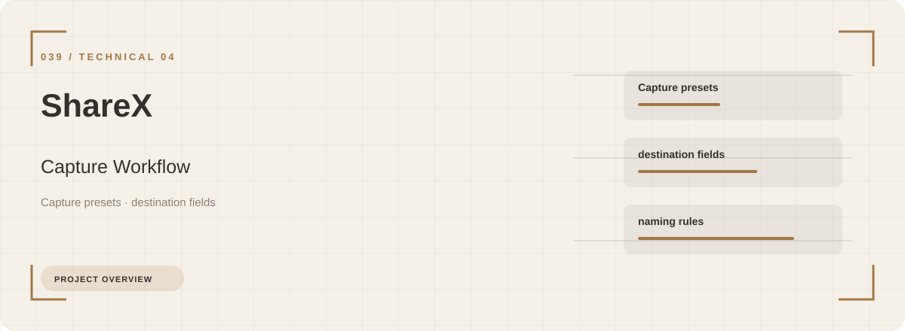
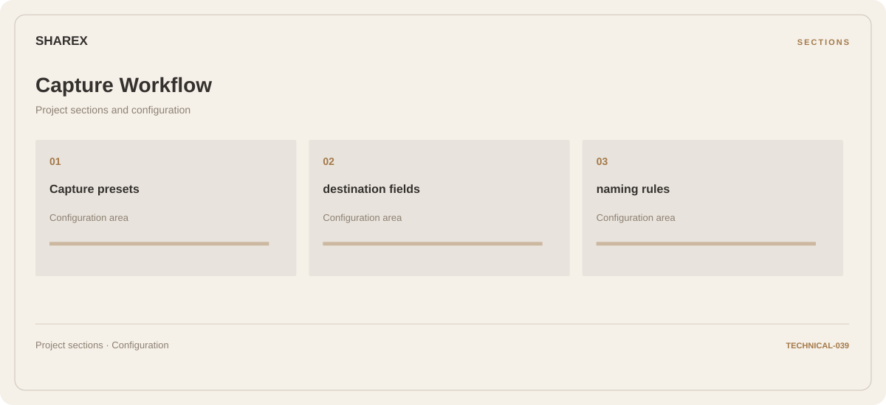

# 🧭 ShareX Capture Workflow

**Capture presets · Destination fields · Naming rules**

## ⚡ Features

Capture presets, destination fields, and naming rules form the core of ShareX Capture Workflow. Related configuration is grouped by task rather than collected in an undifferentiated list.

### ⚙️ Capture presets

Related settings collected into named groups for a clearer configuration workflow.

### 🧩 Destination fields

A dedicated section for destination fields and the configuration details associated with that area.

### ⌨️ Naming rules

A dedicated section for naming rules and the configuration details associated with that area.

## 🖥️ Project navigation

## 📥 Download

The button and cover open the project's download page. Use the information supplied with the downloaded package for installation and release-specific requirements.

## 📚 Project documentation

- [Feature reference](docs/FEATURES.md)
- [Download information](docs/DOWNLOAD.md)
- [Project page](index.html)

---

ShareX Capture Workflow · Program documentation and download information.
